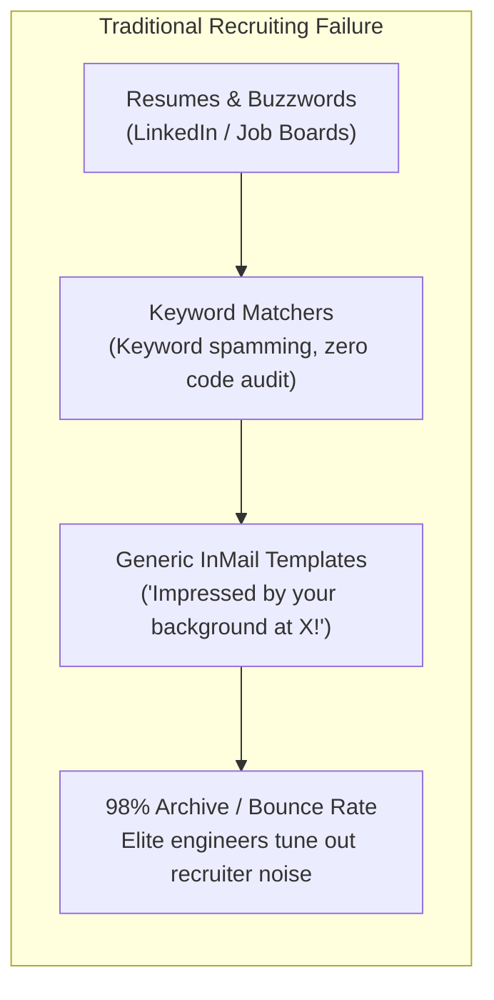
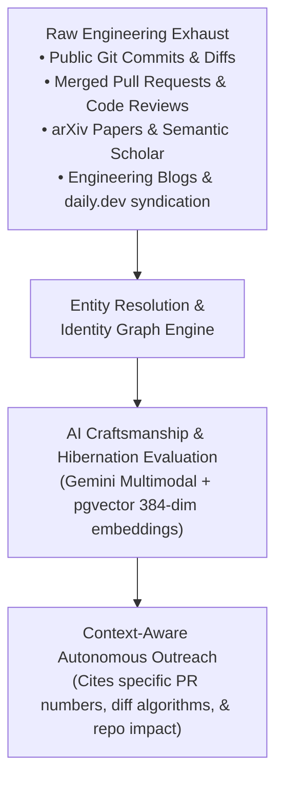
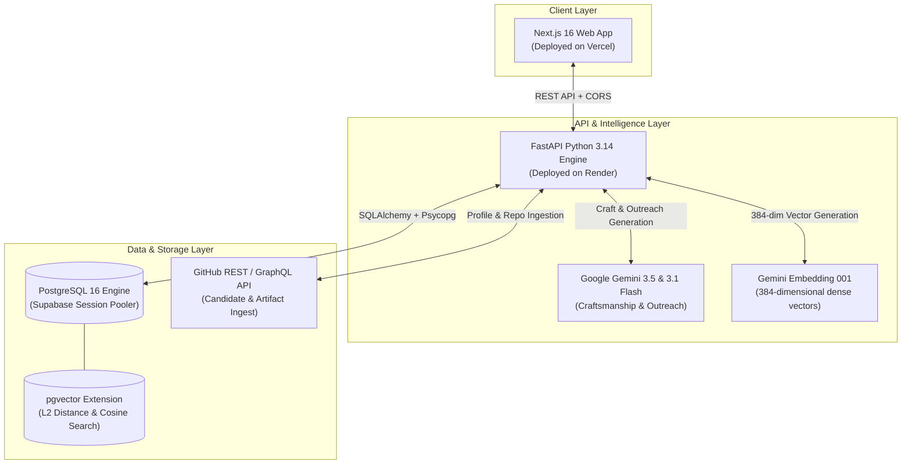
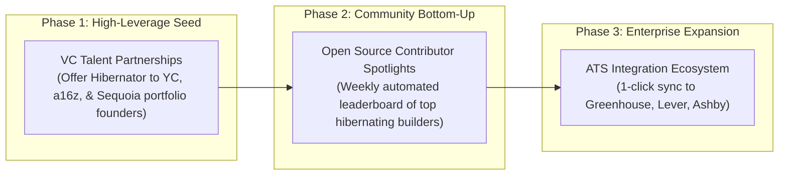

# Hibernator: Executive & Team Business Deck

> **Document Type:** 12-Slide Strategic Deck & Product Onboarding Brief  
> **Target Audience:** Engineering Teammates, Product Leads, Technical Investors  
> **Version:** 1.0.0 | Q1 2026  
> **Status:** Production MVP Deployed (Vercel + Render + Supabase pgvector)  

---

## Slide 1: Cover & Vision
### **Hibernator: Autonomous AI Talent Intelligence Engine**
#### *"Sourcing the top 5% of deep engineers who never browse job boards."*

```
   ┌──────────────────────────────────────────────────────────────┐
   │                                                              │
   │    ⌨ H I B E R N A T O R                                    │
   │    Autonomous Technical Talent Sourcing & Craftsmanship      │
   │    Evaluation Engine                                         │
   │                                                              │
   │    Live Production Stack:                                    │
   │    • Frontend: Next.js 16 + Tailwind (Vercel)                │
   │    • Backend: FastAPI + Gemini AI Engine (Render)            │
   │    • Vector Store: PostgreSQL 16 + pgvector (Supabase)       │
   │                                                              │
   └──────────────────────────────────────────────────────────────┘
```

* **Core Premise:** The world's highest-impact software architects, AI kernel developers, and systems engineers rarely update their LinkedIn profiles or tag themselves `#OpenToWork`. They are **"hibernating"**—deep in commits, pull requests, RFC discussions, and research preprints.
* **Our Mission:** Replace generic keyword-matching recruiters with an autonomous, code-literate AI engine that identifies elite builders through verified technical exhaust and connects with them engineer-to-engineer.

---

## Slide 2: The Problem
### **The Passive Technical Talent Paradox**

Conventional technical recruiting is broken on two fundamental fronts:



### The Three Industry Bottlenecks:
1. **Shallow Signal Detection:** Conventional platforms rely on self-reported job titles and keyword stuffing rather than tangible code craftsmanship, commit velocity, or architectural depth.
2. **Template Fatigue & Low Response Rates:** Top engineers receive dozens of copy-pasted recruiter messages weekly. Typical reply rates on InMail hover around **2% to 4%**.
3. **The Sourcing Asymmetry:** Founders and CTOs waste 20+ hours a week manually browsing GitHub repos, arXiv papers, and personal tech blogs trying to identify verified builders.

---

## Slide 3: The Solution
### **Mining Deep Technical Exhaust into Actionable Talent Signals**

Hibernator replaces self-reported resumes with verified, objective digital exhaust:



* **Zero Self-Reporting:** Candidates are evaluated purely on what they have engineered, reviewed, and published.
* **Autonomous Identity Resolution:** Resolves git commit metadata, PGP signing keys, personal blogs, and research author affiliations into a canonical profile.
* **High-Empathy, Code-Specific Outreach:** The AI drafts personalized emails that speak developer-to-developer, referencing actual pull requests, algorithms, and performance improvements.

---

## Slide 4: Core Product Innovations
### **The Three Proprietary Metrics**

```
┌──────────────────────────────────────────────────────────────────────────┐
│                           HIBERNATOR METRIC SUITE                        │
├─────────────────────────┬────────────────────────┬───────────────────────┤
│  Craftsmanship Score    │   Hibernation Index    │   Vector Skill Match  │
│         (0 - 100)       │        (0 - 100)       │     (pgvector 384)    │
├─────────────────────────┼────────────────────────┼───────────────────────┤
│ Evaluates:              │ Evaluates:             │ Evaluates:            │
│ • Code complexity & AST │ • High commit velocity │ • High-dimensional    │
│ • Test coverage impact  │ • Low social noise     │   semantic similarity │
│ • PR review depth       │ • Long role tenure     │ • Matches manager's   │
│ • Architectural clarity │ • Zero job-board footprint natural queries      │
│                         │                        │   against repo summaries│
└─────────────────────────┴────────────────────────┴───────────────────────┘
```

### What Makes This Defensible?
* **Craftsmanship Score ($C_s$):** Uses Gemini to analyze repo complexity, languages, forks, star ratios, and technical summaries.
* **Hibernation Index ($H_i$):** Identifies the holy grail of hiring: developers doing world-class work in stealth without active job-seeking status.
* **Engineer-to-Engineer Voice:** Strips all corporate cheerleading and buzzwords; speaks directly about technical bottlenecks and engineering challenges.

---

## Slide 5: System Architecture & Data Flow
### **Production-Grade Micro-Architecture**



* **Stateless API:** Lightweight FastAPI endpoints with async HTTP client handling high-concurrency GitHub parsing.
* **Unified Database:** PostgreSQL handles relational candidate entities, campaign state, outreach logs, and vector embeddings in a single database without external vector store overhead.
* **Edge-Optimized Web App:** Next.js client renders responsive dashboards, search results, and campaign sequencing interfaces.

---

## Slide 6: Current MVP Status (What is Live Today)
### **Production Capabilities Validated & Tested**

```
┌────────────────────────────────────────────────────────────────────────┐
│                        LIVE DEPLOYMENT STATUS                          │
├─────────────────────────┬──────────────────────────────────────────────┤
│ Frontend (Vercel)       │ https://hibernator-frontend.vercel.app       │
│ Backend API (Render)    │ https://hibernator-backend.onrender.com      │
│ Database (Supabase)     │ PostgreSQL 16 + pgvector (Session Pooler)    │
└─────────────────────────┴──────────────────────────────────────────────┘
```

### Implemented Feature Checklist:
- [x] **Automated Profile Ingestion:** Ingest any GitHub handle (e.g. `torvalds`), fetch profile data, extract top repos, and analyze tech stacks.
- [x] **AI Craftsmanship Evaluation:** Generates automated technical scores ($C_s$ and $H_i$) and 2-sentence technical summaries via Gemini.
- [x] **pgvector Semantic Search:** Real-time semantic querying across all candidates' technical artifacts using 384-dimensional vectors.
- [x] **Campaign Management:** Full campaign creation with customizable target roles and tone profiles (*Engineer-to-Engineer*, *Professional*, *Casual*, *Visionary*).
- [x] **Hyper-Personalized Outreach Drafts:** Generates contextual email subject and body citing exact repository names and technical competencies.
- [x] **Outreach Audit Trail:** Full database logging of generated drafts and outreach history linked to candidate IDs.

---

## Slide 7: Market Opportunity & TAM
### **The $18B Technical Talent Discovery Market**

```
  ┌────────────────────────────────────────────────────────────┐
  │  TOTAL ADDRESSABLE MARKET (TAM)                            │
  │  $18.4 Billion - Global Tech Sourcing & Recruiting Tech    │
  ├────────────────────────────────────────────────────────────┤
  │  SERVICEABLE ADDRESSABLE MARKET (SAM)                      │
  │  $4.2 Billion - Specialized AI, Systems & Deep-Tech Hiring │
  ├────────────────────────────────────────────────────────────┤
  │  SERVICEABLE OBTAINABLE MARKET (SOM)                       │
  │  $340 Million - Early-stage to Growth tech startups &     │
  │  specialized agency headhunters                            │
  └────────────────────────────────────────────────────────────┘
```

### Key Market Tailwinds:
1. **The AI & Systems Talent War:** Compensation for top AI kernel, distributed systems, and CUDA engineers has skyrocketed to \$400K–\$1M+. Companies will pay substantial premiums for tools that access passive candidates.
2. **Decline of Traditional InMail:** Response rates on traditional LinkedIn messaging dropped by 34% over the last 3 years due to automated spam.
3. **Rise of the Builder-Recruiter:** Technical founders and engineering managers are taking over high-touch sourcing from HR generalists.

---

## Slide 8: Business Model & Monetization
### **B2B SaaS + High-Margin Usage Tiers**

```
┌──────────────────┬──────────────────┬──────────────────┬──────────────────┐
│   Starter Tier   │    Pro Studio    │    Enterprise    │ Placement Credit │
├──────────────────┼──────────────────┼──────────────────┼──────────────────┤
│ $299 / month     │ $799 / month     │ $2,499+ / month  │ Pay-Per-Success  │
├──────────────────┼──────────────────┼──────────────────┼──────────────────┤
│ • 1 Seat         │ • 5 Seats        │ • Unlimited Seats│ • Optional       │
│ • 100 Profile    │ • 500 Profile    │ • Full Pipeline  │   recruiter-fee  │
│   Ingests / mo   │   Ingests / mo   │   Sync & API     │   guarantee      │
│ • Semantic Vector│ • Automated Multi│ • Custom ATS     │ • 10% fee on     │
│   Search         │   Touch Outreach │   Integrations   │   successful hire│
│ • Human-in-loop  │ • CRM & Analytics│ • Dedicated IP   │   vs traditional │
│   Outreach Gen   │ • Team Sharing   │   Warmup         │   25% agency fee │
└──────────────────┴──────────────────┴──────────────────┴──────────────────┘
```

### Unit Economics Target:
* **Target LTV:** \$14,000+ per enterprise customer.
* **Target CAC:** \$2,500 (driven by founder networks, open-source evangelism, and content syndication).
* **Gross Margin:** 82% (primarily LLM API and compute hosting costs).

---

## Slide 9: Competitive Landscape & Moat
### **Why Hibernator Wins**

| Feature / Metric | LinkedIn Recruiter | Gem / Apollo | Eightfold AI | **Hibernator** |
| :--- | :--- | :--- | :--- | :--- |
| **Primary Data Source** | Resumes / Self-reported | Scraped social profiles | Enterprise HR data | **Public Code Diffs + Repos + Preprints** |
| **Detection Target** | Active job-seekers | General workers | Internal mobility | **Passive ("Hibernating") deep builders** |
| **Signal Depth** | Titles & Keywords | Email addresses | Past company names | **AST Complexity, PR Diffs, Star Ratios** |
| **Search Paradigm** | Boolean filters | Keyword searches | Career path models | **Natural Language Vector Search (pgvector)**|
| **Outreach Quality** | Templated spam | Variable mail merges | Automated triggers | **Technical engineer-to-engineer deep hooks** |
| **Avg. Reply Rate** | 2% – 5% | 8% – 12% | Internal only | **Target: 28% – 42%** |

### Our Defensible Moat:
1. **The Identity Graph:** Resolving anonymous GitHub handles, git commit emails, and arXiv author profiles into one verified entity.
2. **Proprietary Scoring:** Combining code craftsmanship metrics with our passive Hibernation Index.
3. **Engineering Brand Trust:** Emails written by Hibernator are indistinguishable from genuine peer engineering outreach.

---

## Slide 10: Go-To-Market (GTM) Strategy
### **Land & Expand via Founders, VCs, and Open Source**



### Strategic Tactics:
* **Founder-to-Founder Pilot Programs:** Target 25 Seed/Series A AI infrastructure startups desperate for distributed systems engineers.
* **"Hibernator Index" Public Leaderboards:** Publish bi-weekly engineering retrospective reports highlighting the most innovative open-source contributions across AI repositories.
* **Proof-of-Value Guarantee:** Guarantee 3 verified technical candidate interviews within 14 days or full refund.

---

## Slide 11: 3-Phase Execution Roadmap
### **From Working Prototype to Market Leadership**

```
┌────────────────────────────────────────────────────────────────────────┐
│                        DEVELOPMENT ROADMAP                             │
├────────────────────┬────────────────────┬──────────────────────────────┤
│  Phase 1 (CURRENT) │  Phase 2 (Q2 2026) │  Phase 3 (Q3-Q4 2026)        │
│    Foundation      │    Multi-Signal    │      Scale & Ecosystem       │
├────────────────────┼────────────────────┼──────────────────────────────┤
│ • GitHub Ingestion │ • arXiv CS Crawler │ • Greenhouse/Ashby ATS Sync  │
│ • pgvector Search  │ • daily.dev Ingest │ • Chrome Extension for       │
│ • Gemini Scoring   │ • Automated Email  │   GitHub & arXiv browsing    │
│ • Campaign CRM     │   Delivery Webhooks│ • Team collision prevention  │
│ • Human-in-loop    │ • Identity Graph   │ • Organization talent pools  │
│   Outreach Engine  │   Auto-Resolution  │ • Dedicated warm-up domains  │
└────────────────────┴────────────────────┴──────────────────────────────┘
```

---

## Slide 12: Team Roles & Immediate Next Steps
### **Sprint Responsibilities for Incoming Teammates**

```
┌─────────────────────────┬──────────────────────────────────────────────┐
│ Team Role               │ Immediate 30-Day Objective                   │
├─────────────────────────┼──────────────────────────────────────────────┤
│ Frontend Engineer       │ • Refine candidate dossier view (diff view,  │
│                         │   badges, rich repo inspection modal).       │
│                         │ • Add campaign analytics & conversion stats. │
├─────────────────────────┼──────────────────────────────────────────────┤
│ Backend / Data Engineer │ • Expand GitHub ingest pipeline with rate-   │
│                         │   limited worker queues (Redis / BullMQ).    │
│                         │ • Implement arXiv preprint scraper.          │
├─────────────────────────┼──────────────────────────────────────────────┤
│ AI / ML Engineer        │ • Fine-tune craftsmanship scoring prompts.   │
│                         │ • Implement multi-turn outreach follow-up    │
│                         │   cadence logic.                             │
├─────────────────────────┼──────────────────────────────────────────────┤
│ Product / GTM Lead      │ • Run onboarding interviews with 10 technical│
│                         │   hiring managers.                           │
│                         │ • Launch first pilot campaign with partner VC│
└─────────────────────────┴──────────────────────────────────────────────┘
```

### Immediate Action Items for the Team:
1. **Repository Access:** Clone from `sticker-s/hibernator` on GitHub.
2. **Environment Setup:** Review `d:\ricoz\.env` template (FastAPI backend + Next.js frontend).
3. **Database Architecture:** Review PostgreSQL schema in `app/models/models.py` (pgvector tables).
4. **First Sprint Goal:** Add candidate code diff preview inside the candidate cards in the frontend.

---

> **Prepared for Team Alignment & Distribution.**  
> *Hibernator Engine — Sourcing the Builders Behind Tomorrow's Systems.*

